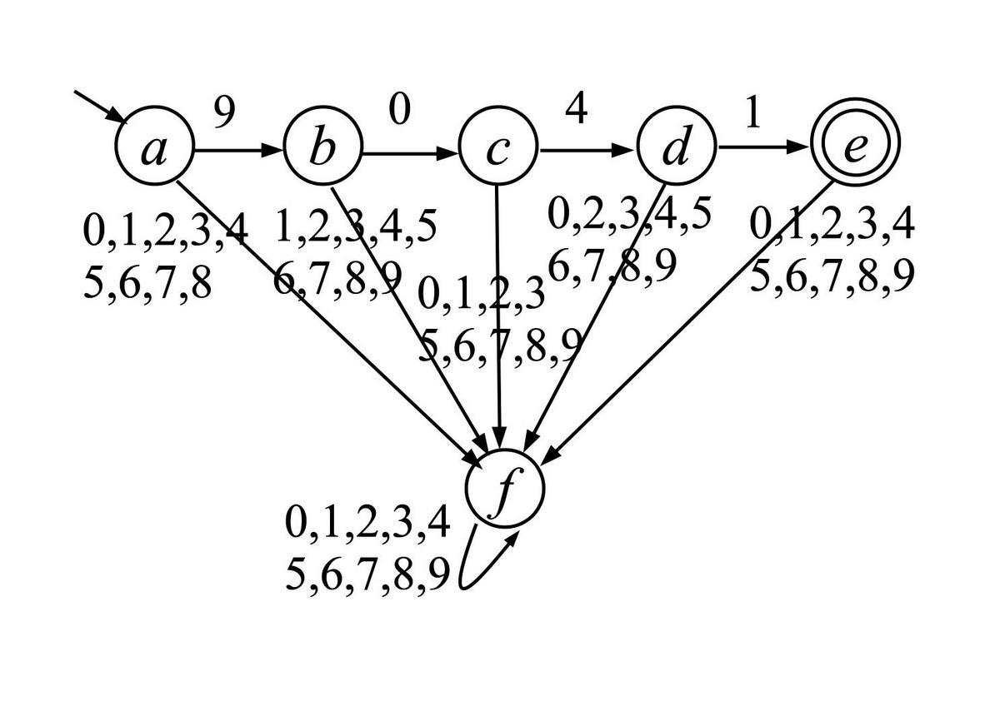
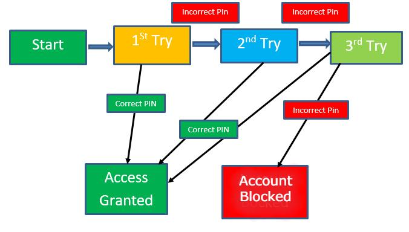
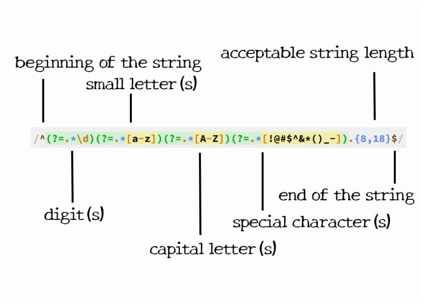
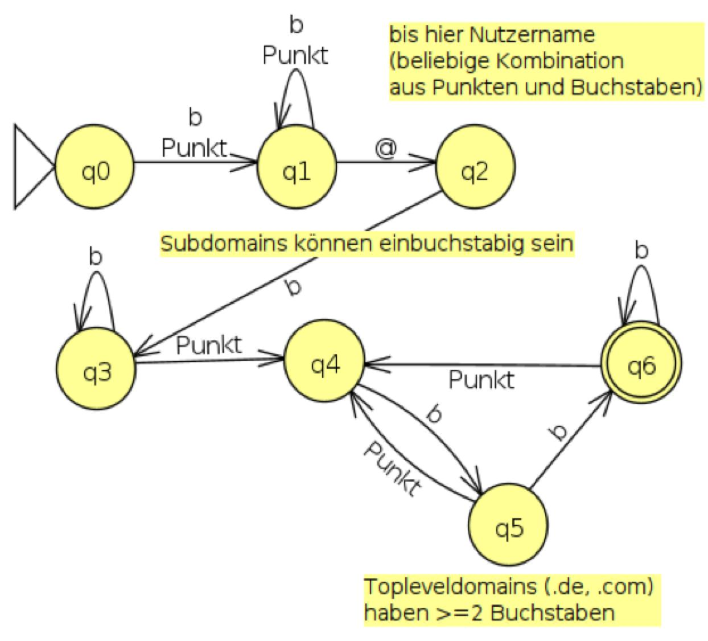
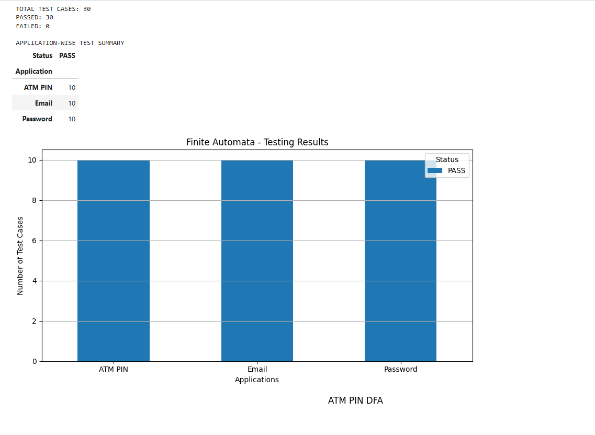

 # Finite Automata for Real-Time Validation

## Student Details

- **Name:** Dande Durga Prasad
- **Register Number:** RA2411026050066
- **Course:** 21CSC301T – Formal Language and Automata
- **Institution:** SRM Institute of Science and Technology, Tiruchirappalli

## 1. Project Overview

This project demonstrates the application of Finite Automata in real-time validation systems using Python. It focuses on validating ATM PINs, ATM card-lock operations, passwords, and email addresses using automata-based techniques.

## 2. Applications Implemented

### 2.1 ATM PIN Validation

A Deterministic Finite Automaton (DFA) is used to validate an ATM PIN containing exactly four digits.

**Examples:**
- `4821` – Accepted
- `123` – Rejected
- `48211` – Rejected

### 2.2 ATM Card Lock System

This application simulates an ATM card-lock mechanism. The card gets locked after three consecutive incorrect PIN attempts. Entering a correct PIN resets the wrong-attempt counter.

**Examples:**
- `WWW` – Card Locked
- `WWC` – Card remains unlocked; counter resets.

### 2.3 Password Validation

The password validation system checks the following conditions:

- Minimum length: 8 characters.
- Maximum length: 16 characters.
- At least one uppercase letter.
- At least one lowercase letter.
- At least one digit.
- At least one special character.

**Examples:**
- `Srm@2026` – Accepted
- `srm@2026` – Rejected

### 2.4 Email Validation

The email validation system checks email addresses using finite automata-based validation rules.

**Examples:**
- `student@gmail.com` – Accepted
- `student@@gmail.com` – Rejected

## 3. Automata Diagrams

### 3.1 ATM PIN Validation DFA

### 3.2 ATM Card Lock DFA

### 3.3 Password Validation

### 3.4 Email Validation

## 4. Test Cases and Results

The following table shows representative validation examples.

| Application | Input | Expected Result |
|---|---|---|
| ATM PIN | `4821` | Accepted |
| ATM PIN | `123` | Rejected |
| ATM Card Lock | `WWW` | Locked |
| ATM Card Lock | `WWC` | Unlocked |
| Password | `Srm@2026` | Accepted |
| Password | `srm@2026` | Rejected |
| Email | `student@gmail.com` | Accepted |
| Email | `student@@gmail.com` | Rejected |

### Execution Results Screenshot

## 5. Technologies Used

- Python
- Google Colab
- Finite Automata
- Deterministic Finite Automaton (DFA)
- State Transitions
- Matplotlib

## 6. Project Outcome

The project demonstrates how finite automata can be applied to practical validation problems. It illustrates state transitions, acceptance conditions, and rejection conditions in different real-time validation applications.

## 7. Conclusion

Finite Automata provide an effective method for validating structured input. Through this project, ATM PIN validation, card-lock operations, password validation, and email format validation are demonstrated using Python.

## 8. Project Notebook

The complete Python implementation and execution are available in the following notebook:

[FLA_TASK_2.ipynb](FLA_TASK_2.ipynb)

## 9. Repository Contents

- `FLA_TASK_2.ipynb` – Python implementation.
- `README.md` – Project documentation.
- `atm_pin_dfa.png` – ATM PIN DFA diagram.
- `card_lock_dfa.png` – ATM card-lock diagram.
- `password_dfa.png` – Password validation diagram.
- `email_dfa.png` – Email validation diagram.
- `test_results.png` – Execution results screenshot.
